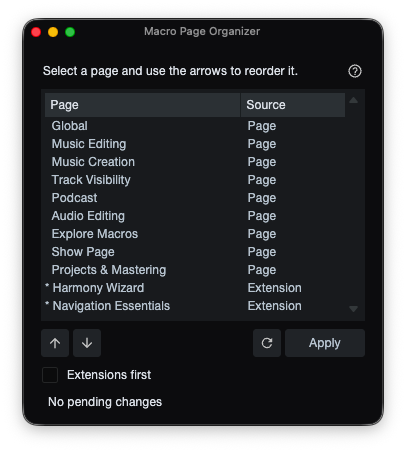

# Macro Page Organizer

A Studio Pro panel for reordering and managing macro pages in the Macro Toolbar page list.

Click for details

The **Macro Page Organizer** package in this repository demonstrates:

- A `FrameworkService` and `WindowClass` panel
- A `Host:ListViewModel` populated with macro and macro extension pages
- Applying page order changes to the live Macro Toolbar page list
- Persisting the **Extensions first** preference

**Source Code Files:**

- [`classfactory.xml`](https://github.com/CSources/Studio-Pro-Scripting-API-Reference/blob/main/scripts/sources/macropage-organizer-source/classfactory.xml)
- [`metainfo.xml`](https://github.com/CSources/Studio-Pro-Scripting-API-Reference/blob/main/scripts/sources/macropage-organizer-source/metainfo.xml)
- [`main.js`](https://github.com/CSources/Studio-Pro-Scripting-API-Reference/blob/main/scripts/sources/macropage-organizer-source/main.js)
- [`skin/skin.xml`](https://github.com/CSources/Studio-Pro-Scripting-API-Reference/blob/main/scripts/sources/macropage-organizer-source/skin/skin.xml)
- [`up.svg`](https://github.com/CSources/Studio-Pro-Scripting-API-Reference/blob/main/scripts/sources/macropage-organizer-source/skin/images/up.svg)
- [`down.svg`](https://github.com/CSources/Studio-Pro-Scripting-API-Reference/blob/main/scripts/sources/macropage-organizer-source/skin/images/down.svg)
- [`refresh.svg`](https://github.com/CSources/Studio-Pro-Scripting-API-Reference/blob/main/scripts/sources/macropage-organizer-source/skin/images/refresh.svg)
- [`help.svg`](https://github.com/CSources/Studio-Pro-Scripting-API-Reference/blob/main/scripts/sources/macropage-organizer-source/skin/images/help.svg)

**Key features:**

- Reorder macro pages with simple arrow buttons
- Double-click a saved page to rename it; right-click to remove it
- Put extension pages first in the list

[⬇ Download Package](https://raw.githubusercontent.com/CSources/Studio-Pro-Scripting-API-Reference/main/scripts/packages/macro-page-organizer/Macro%20Page%20Organizer.package)

## Overview

The organizer lists macro pages from `local://$USERCONTENT/Macros/commandbar-v3.xml` and extension .macropage files from extensions in the Studio Pro Extensions folder. Both appear in one list.

## Usage

1. Open Find Command **(Ctrl/Cmd + K)**: then search and select "Macro Page Organizer" to open the panel.
2. Select a macro page in the list and use the arrows to reorder it.
3. Choose **Apply** to update the Macro Toolbar page list.

## Tips

- Extension macro pages are marked with an asterisk and **Extension** source label. These cannot be renamed, removed, or reordered independently.
- Enable **Extensions first** to place extension macro pages at the top of the list.

---

> **Development Note:** This script and its documentation were developed with the assistance of agentic coding tools.
